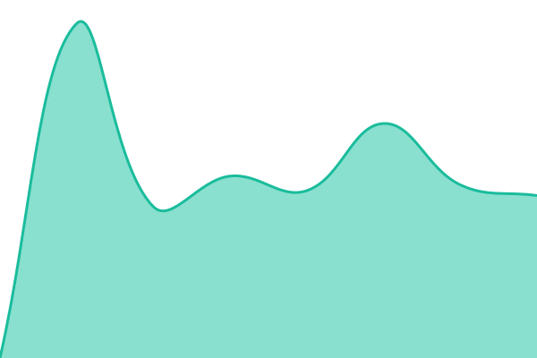
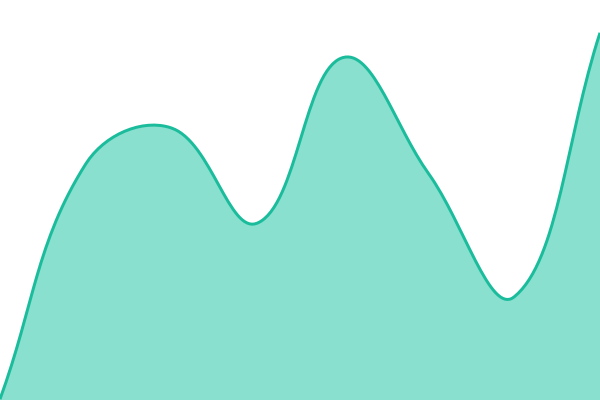

# [📈 Live Status](https://status.bouncesports.co): <!--live status--> **🟩 All systems operational**

This repository contains the open-source uptime monitor and status page for [BounceSports](https://status.bouncesports.co), powered by [Upptime](https://github.com/upptime/upptime).

With [Upptime](https://upptime.js.org), you can get your own unlimited and free uptime monitor and status page, powered entirely by a GitHub repository. We use [Issues](https://github.com/BounceSports/status/issues) as incident reports, [Actions](https://github.com/BounceSports/status/actions) as uptime monitors, and [Pages](https://status.bouncesports.co) for the status page.

<!--start: status pages-->
<!-- This summary is generated by Upptime (https://github.com/upptime/upptime) -->
<!-- Do not edit this manually, your changes will be overwritten -->
<!-- prettier-ignore -->
| URL | Status | History | Response Time | Uptime |
| --- | ------ | ------- | ------------- | ------ |
|  [Integrations API](https://api.bouncesports.co/health) | 🟩 Up | [integrations-api.yml](https://github.com/BounceSports/status/commits/HEAD/history/integrations-api.yml) | 

 633ms
     
 | 

<a href="https://status.bouncesports.co/history/integrations-api">100.00%</a>
    

|  [Integrations API (staging)](https://api-staging.bouncesports.co/health) | 🟩 Up | [integrations-api-staging.yml](https://github.com/BounceSports/status/commits/HEAD/history/integrations-api-staging.yml) | 

 529ms
     
 | 

<a href="https://status.bouncesports.co/history/integrations-api-staging">100.00%</a>
    

|  [Shop](https://bouncesports.co) | 🟩 Up | [shop.yml](https://github.com/BounceSports/status/commits/HEAD/history/shop.yml) | 

 589ms
     
 | 

<a href="https://status.bouncesports.co/history/shop">100.00%</a>
    

|  [Bounce Pro simulator](https://pro-simulation.bouncesports.co) | 🟩 Up | [bounce-pro-simulator.yml](https://github.com/BounceSports/status/commits/HEAD/history/bounce-pro-simulator.yml) | 

 845ms
     
 | 

<a href="https://status.bouncesports.co/history/bounce-pro-simulator">100.00%</a>
    

|  [Bounce Ops](https://ops.bouncesports.co) | 🟩 Up | [bounce-ops.yml](https://github.com/BounceSports/status/commits/HEAD/history/bounce-ops.yml) | 

 822ms
     
 | 

<a href="https://status.bouncesports.co/history/bounce-ops">100.00%</a>
    

|  [FFT campaign](https://campagne-fft.bouncesports.co) | 🟩 Up | [fft-campaign.yml](https://github.com/BounceSports/status/commits/HEAD/history/fft-campaign.yml) | 

 1512ms
     
 | 

<a href="https://status.bouncesports.co/history/fft-campaign">100.00%</a>
    

|  [Partner offers](https://partnership.bouncesports.co) | 🟩 Up | [partner-offers.yml](https://github.com/BounceSports/status/commits/HEAD/history/partner-offers.yml) | 

 1910ms
     
 | 

<a href="https://status.bouncesports.co/history/partner-offers">100.00%</a>
    

|  [Bounce Circular](https://circular.bouncesports.co) | 🟩 Up | [bounce-circular.yml](https://github.com/BounceSports/status/commits/HEAD/history/bounce-circular.yml) | 

 331ms
     
 | 

<a href="https://status.bouncesports.co/history/bounce-circular">100.00%</a>
    

|  [Odoo](https://odoo.bouncesports.co/web/health) | 🟩 Up | [odoo.yml](https://github.com/BounceSports/status/commits/HEAD/history/odoo.yml) | 

 3195ms
     
 | 

<a href="https://status.bouncesports.co/history/odoo">100.00%</a>
    

<!--end: status pages-->

[**Visit our status website →**](https://status.bouncesports.co)

## 📄 License

- Powered by: [Upptime](https://github.com/upptime/upptime)
- Code: [MIT](./LICENSE) © [Anand Chowdhary](https://anandchowdhary.com)
- Data in the `./history` directory: [Open Database License](https://opendatacommons.org/licenses/odbl/1-0/)
